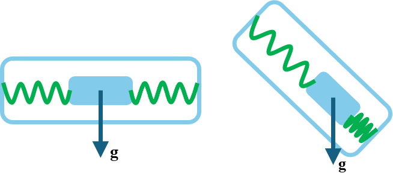
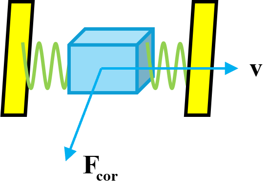

## 1 传感器的作用

基本传感器的作用是感知自身的位置与姿态。

## 2 常见的基本传感器

### 2.1 加速度计

加速度计通过测量比力 $\mathbf{f} = \mathbf{a} - \mathbf{g}$，依据牛顿第二定律来测算无人机的线加速度，常用于以重力为参考的姿态解算。通常地，加速度计只能测算出俯仰角与横滚角，而偏航角无法测量。

*图 1　加速度计简图*

### 2.2 陀螺仪

陀螺仪通常用来测算无人机的角速度。

核心原理为科里奥利力（科氏力）：一个质点相对于惯性系做直线运动时，由于质点自身的惯性，它相对于旋转体系的轨迹是一条曲线；立足于旋转体系，则可认为有一个力驱使质点的轨迹弯曲。科氏力的计算公式如下

$$\mathbf{F}_c = -2m(\boldsymbol{\omega} \times \mathbf{v})$$

式中，$m$ 为物体质量，$\omega$ 为旋转体的角速度，$v$ 为物体的运动速度。

无人机上的陀螺仪内部并没有高速旋转的陀螺，而是振动式 MEMS（微机电系统）陀螺：使其沿驱动轴来回做高频往复运动，得到固定的速度 $v$；当无人机发生旋转时存在角速度 $\omega$，这个往复运动的质量块处于旋转坐标系中，因而受到科氏力。该系统边缘布置了电容电极，质量块在电场方向发生偏移后，两侧电极的电容值随之变化，电路将其转化为电压信号，飞控芯片读取该电压信号并通过算法解算出角速度。

*图 2　MEMS 陀螺仪简图*

### 2.3 三轴磁力计

三轴磁力计是用来解算飞机偏航角的传感器。

地球本身存在地磁场，在近地面，地磁场是一个空间矢量 $\mathbf{B}$，它可以被分解为三个彼此正交的磁场分量，即

$$\mathbf{B} = (B_x,\ B_y,\ B_z)$$

当飞机不发生俯仰与滚转时，$z$ 轴方向竖直向上，地磁场在竖直方向上的分量不受影响，只需用到水平面内的分量即可算出偏航角，即

$$\psi = \operatorname{arctan2}(-B_y,\ B_x)$$

当飞机发生俯仰与滚转时，$z$ 轴方向不再竖直向上，磁力计的 $x\text{-}y$ 平面不再平行于地面。此时应当先计算倾斜补偿：利用加速度计解算出俯仰角与滚转角，再通过旋转矩阵将磁力计测得的三维磁场向量转换到地面坐标系，用转换之后的数据按上式计算出偏航角。

### 2.4 IMU 惯性测量单元

标准 6 轴 IMU 传感器由三轴陀螺仪与三轴加速度计组成，可以测算出角速度与线加速度，但无法得到偏航角。

由于材料性质、电路噪声或加工误差等原因，陀螺仪在静止时仍会输出不为零的角速度，这是 IMU 的主要误差来源，起飞前对陀螺仪进行零点校准即是为了减小此项误差。同时，无人机的高频振动传导到 IMU 会引入噪声数据，因此飞控需要对其进行滤波。

### 2.5 AHRS 姿态航向参考系统

标准 9 轴 AHRS 传感器由三轴陀螺仪、三轴加速度计与三轴磁力计（磁罗盘）组成，可以测算出完整的飞机姿态信息。

三轴陀螺仪求解姿态角时需要对角度积分，会产生累积误差；而三轴加速度计与磁力计动态响应较差、测量噪声较大。为融合这些传感器的信息、取长补短，通常采用互补滤波或卡尔曼滤波进行数据融合。为避免万向节死锁，AHRS 采用四元数进行姿态解算，计算完毕后再转回欧拉角，返回给飞控程序。

严格来说，AHRS 并非独立的一种硬件物理传感器。

### 2.6 气压高度计

用于测量无人机海拔高度。

气压随海拔上升而减小，基于此，利用国际标准大气模型公式可以将当前气压换算为海拔高度。它可实现悬停、自动爬升下降等功能，在隧道、偏僻地区等 GPS 信号弱的场景表现良好；通过算法融合 GPS 高度数据，可以输出更可信的高度。但受天气、气温等影响，气压计容易飘高，输出误差较大甚至给出不可信的高度数据。

### 2.7 光流传感器

用于测量无人机相对地面的水平速度。

光流传感器在无人机上向下安装，利用灰度摄像头不停拍摄地面，通过比对纹理计算出像素的移动速度，并搭配测距传感器与陀螺仪数据，消除姿态偏转带来的虚假光流，转换为真实速度。它常用于 GPS 不可用的环境，如有限空间内无人机的速度测算与悬停。

若通过光流传感器计算位移，需要对速度积分，会带来相应的积分累积误差，因此长时间的悬停会导致飞机偏移。在地面纹理单一或光照不佳时，光流传感器可能失效；高度过高时地面纹理移动太慢，精度同样会下降。

### 2.8 超声波测距传感器

超声波传感器发出高频声波，声波碰到地面后反射回来，传感器测算出声波的往返时间，利用声速计算出距离，即为高度。

超声波传感器搭配光流传感器可以实现不依赖 GPS 的原地悬停，且不受地面材质与环境光照的影响。

声速会随温度、湿度等外部环境变化，导致计算出现误差。由于波的衍射，声波发出后会形成锥形，在高度较低时，地面表面复杂起伏或周边墙壁都有可能被波及，从而误判距离；气流与螺旋桨的扰动也会产生影响；倾斜的地面则容易造成回波丢失。

### 2.9 ToF 红外激光测距传感器

发射一束红外激光脉冲，激光打到地面后反射，传感器记录激光的往返时间，光速已知，可直接算出距离。

相比超声波测距，红外测距仅打出一个向下的小点，波束窄、不易发散、方向性好，且测距距离长、响应速度快。但在透明介质（如玻璃、水面）附近，部分激光会被吸收或透射，削弱回波，影响测距精度。

### 2.10 扫描式激光雷达

发射一束短促的激光脉冲，计时器记录激光从发射、打到物体、反射回到传感器的往返时间。常见有 2D、3D 与固态激光雷达等。激光雷达输出点云，可用于测高、避障、SLAM 建图与重定位；其测距距离远、激光发散小、不易受光照影响。

扫描式激光雷达内部需要高速旋转，抗震、抗摔性能差；在雨、雾、浓烟等环境下，激光易受干扰，性能下降。

### 2.11 毫米波雷达

用于低空定高与避障。

发射调频连续波，通过解算发射波与回波的拍频信号得到目标的距离、相对径向速度（利用多普勒频移）与方位角。

其波长在毫米级（如 24 GHz、77 GHz），具备极强的透雾、穿雨、穿尘与抗光照干扰能力，特别适用于低空植保、海面巡检。相比激光雷达，其角分辨率与点云稠密度较低；对金属与强反射介质灵敏，但容易在复杂起伏的地面产生杂波。

### 2.12 GNSS / RTK 卫星定位模块

提供室外环境下的全球绝对地理坐标（经度、纬度、椭球高/大地高）以及三维地速（NED 系速度）。

接收来自 GPS、BDS（北斗）、GLONASS、Galileo 等多星座卫星的伪距与载波相位信号，利用三球交会测定接收机坐标。RTK 通过基准站向机载流动站（Rover）播发载波相位差分修正数据，实时消除电离层/对流层延迟误差，将常规定位精度从米级（1–3 m）提升至厘米级（1–2 cm）。

但它依赖卫星视距传播；在城市立面（高楼峡谷）存在多径效应；在地下、室内、树冠遮蔽区及电磁压制环境下会失锁。
