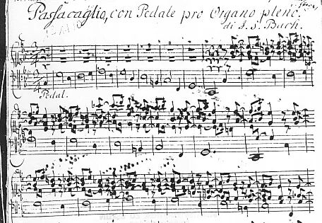
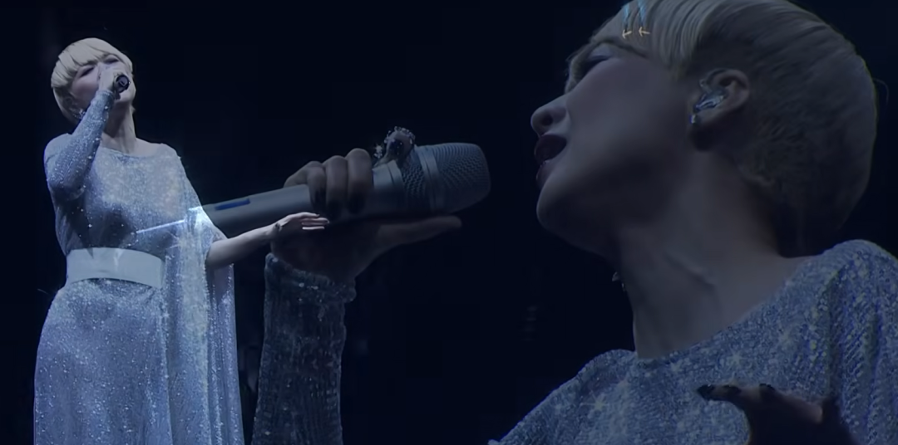

今天，我们来聊聊音乐。阅读这篇文章前，笔者建议您首先回顾这首经典粤语作品《傻女》的主旋律。

写在前面：这篇文章将论述我标题所阐释的观点。文章尽量以通俗易懂的叙事语言来论证，尽量避开音乐理论，让所有乐迷都能读懂，都能理解。由陈慧娴演唱的《傻女》，发行于 1988 年的《娴情》大碟中。

## 一、那天我在听亨德尔，却突然听到了《傻女》

有些音乐之间的联系，不是靠分析，而是靠“撞见”。

那天我在听亨德尔式的一段帕萨卡里亚（Passacaglia）式写法——低音反复、旋律在上方缓缓推进，像是情绪在同一个轨道上不断加深。

听着听着，我突然愣住了。

那种循环的低音、那种层层堆叠的情绪、那种带着宿命感的推进方式……怎么这么耳熟？

脑海里突然跳出一句旋律——陈慧娴《傻女》。

那一刻，我意识到：我痴迷的那首粤语歌，竟然和亨德尔的帕萨卡里亚式段落有着惊人的相似。

又想到：陈慧娴的《傻女》翻自西班牙流行音乐《La Loca》。

这一切是不是有必然的联系呢？

顺着这条线索往回追，我竟然一路追到了西班牙、巴洛克、拉丁音乐，再回到香港流行文化的黄金时代。

## 二、帕萨卡里亚（Passacaglia）是什么？

Passacaglia（西班牙语：pasacalle），源自西班牙语的 pasar（十字、山口）和 calle（街道），原意为街头艺人边走边演奏的音乐形式。

公认地，帕萨卡里亚源自于 17 世纪初的西班牙，但最早，类似帕萨卡里亚的音乐早在 1606 年的意大利文献中就有记载，这些作品以及意大利原著中的其他作品，都是简短简单的和弦序列，勾勒出旋律走向。

1620 年代末，意大利作曲家吉罗拉莫·弗雷斯科巴尔迪重新定义了帕萨卡里亚，将其改编为一系列在低音上连续变奏的音乐形式。

类似的音乐形式——恰空——也由弗雷斯科巴尔迪首次发展。帕萨卡里亚和恰空共同构成了巴洛克音乐的主流题材。

巴赫小提琴恰空舞曲

帕萨卡里亚的三大特征：固定低音反复出现；旋律在上方不断变奏；情绪呈螺旋式累积。

但帕萨卡里亚真正迷人的地方，不只在于音乐结构，而还在于它背后的人文意义。

## 三、帕萨卡里亚的人文意义：在循环中理解命运

帕萨卡里亚的核心，是一种“固定低音的循环”。这不仅是一种写作技巧，更是一种世界观。

它告诉我们：命运像低音，不会改变；人生像旋律，在其上不断变奏。

人无法逃离命运的底色，但可以在命运之上创造不同的情绪、不同的姿态。重复不是停滞，而是深化；循环不是困住，而是让人一次次回到同一个问题，再用不同方式回答。

*约翰·塞巴斯蒂安·巴赫创作的 C 小调帕萨卡利亚与赋格手稿首页，BWV 582。图源：维基百科*

帕萨卡里亚是一种“宿命中的自由”。低音是宿命，旋律是自由，人在循环中挣扎、成长、沉沦、醒悟。

这种哲学意味，恰恰与《傻女》的歌词情绪产生了惊人的共鸣。

当然，过了这么多年，林振强当年填词时有没有考虑到这一点我们已然无从考证，然而我们从这个角度来进行赏析也不错。

《傻女》的歌词讲述的是一个反复受伤却仍然投入的女孩。她明知道结果，却仍然义无反顾；明知道会痛，却仍然选择爱。

她的爱情不是直线，而是循环。不是逃离，而是回到同一个痛点，再用不同方式爱一次。

这不正是帕萨卡里亚的情绪结构吗？

帕萨卡里亚的低音循环，是命运的底色；《傻女》的情感循环，是爱情的宿命。

她的“傻”，不是愚蠢，而是执念、深情、宿命感。

她的悲伤不是突然的，而是螺旋式加深的——每一次回到同一个情绪，都比上一次更深一层。

这正是帕萨卡里亚的精神：在循环中加深，在重复中沉入命运的核心。

## 四、从西班牙到拉丁，再到香港：一条跨越三百年的音乐血脉

需要声明的是，《傻女》并不是原创旋律，而是改编自拉丁流行曲《La Loca》。而拉丁音乐本身深受西班牙音乐影响。

换句话说，帕萨卡里亚的结构基因，很可能在拉丁音乐里以一种“潜意识的方式”延续下来。它不再是古典音乐中的严格变奏，而是变成一种情绪推进的习惯、一种旋律构建的方式。

于是，当《La Loca》被改编成《傻女》时，这种结构也被带到了粤语流行音乐里。

这是一条非常迷人的音乐迁徙路径：从十七世纪的西班牙街头，到巴洛克时期的亨德尔；从欧洲的宫廷音乐，到拉丁美洲的节奏传统；从八十年代的拉丁流行，到香港的黄金时代。

音乐在文化之间流动，像基因一样，在不同的时代重新组合、重新发芽。

## 五、为什么《傻女》听起来如此“宿命”

很多人说《傻女》有一种“命中注定的悲伤”。其实，这种感觉并不是来自歌词，而是来自旋律结构本身。

帕萨卡里亚式的循环低音，天然带着一种“无法逃离”的意味；旋律在重复中逐渐加深，带着一种“命中注定”的悲伤；情绪在螺旋式的推进中不断累积，直到副歌时终于爆发。

> 重饰演某段美丽故事主人
>
> 饰演你旧年共寻梦的恋人
>
> 再去做没流着情泪的伊人
>
> 假装再有从前演过的戏份
>
> 重饰演某段美丽故事主人
>
> 饰演你旧年共寻梦的恋人
>
> 你纵是未明白仍夜深一人
>
> 穿起你那无言毛衣
>
> 当跟你贴近

于是，《傻女》听起来不仅是一个爱情故事，而是一种宿命的叙述。它的悲伤不是突如其来，而是从第一句旋律开始，就已经注定。

## 六、结语：音乐的血脉比我们想象的更长

当我们以为自己在听一首八十年代的粤语流行歌时，其实我们听到的是三百年前的影子。我们听到的是亨德尔的脚步声，是西班牙舞曲的节奏，是拉丁音乐的脉络，是香港流行文化的黄金时代。

*2014 年，陈慧娴在 Back to Priscilla 30 周年演唱会尾声时，再度动人演绎《傻女》*

音乐从来不是孤立的。它跨越时代、跨越地域、跨越文化，在不经意间流入我们耳熟能详的旋律里。

《傻女》之所以动人，不仅因为它的旋律、歌词、演唱，更因为它背后那条跨越三百年的音乐血脉。

你以为你听的是一首粤语歌

但它的情绪结构

早在十七世纪就已经定下

## References

- [BBC Music Magazine, 2023, *What is Passacaglia?*](https://www.classical-music.com/features/musical-terms/discovering-music-passacaglia)
- [Wikipedia: Passacaglia](https://en.wikipedia.org/wiki/Passacaglia#Further_reading)
- [The Passacaglia (Handel/Halvorsen) for Piano — Oktav](https://www.oktav.com/en/c/passacaglia-handel)
- [Passacaglia: A Music Form of Continuous Variation and a Courtly Dance — M5 Music](https://www.m5music.hk/en/dictionary/passacaglia/)

---

作者：SD_1631

若有不适与牵强之处，请多多包容。
